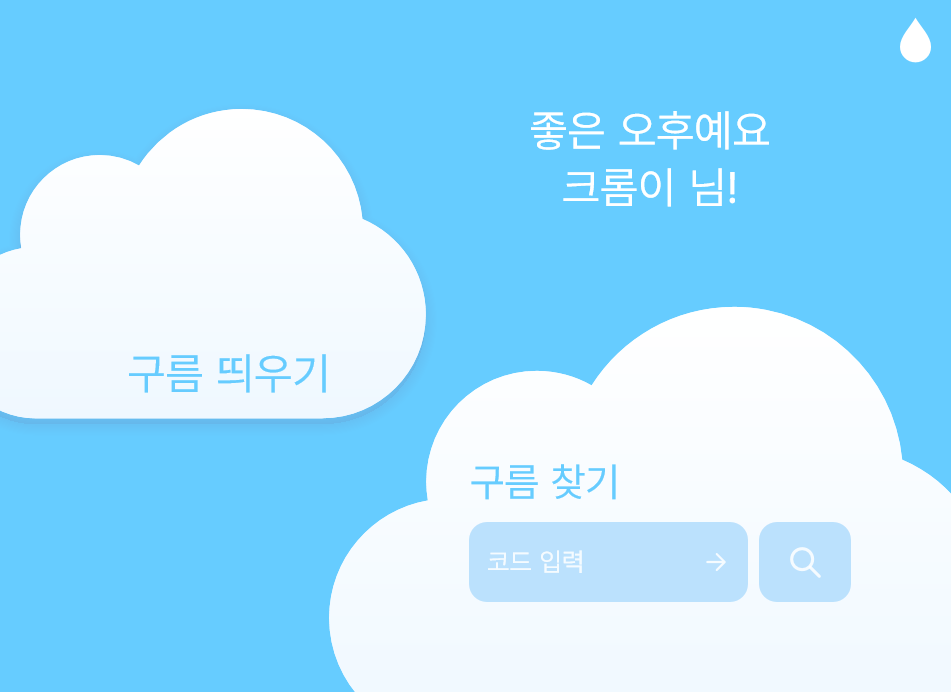
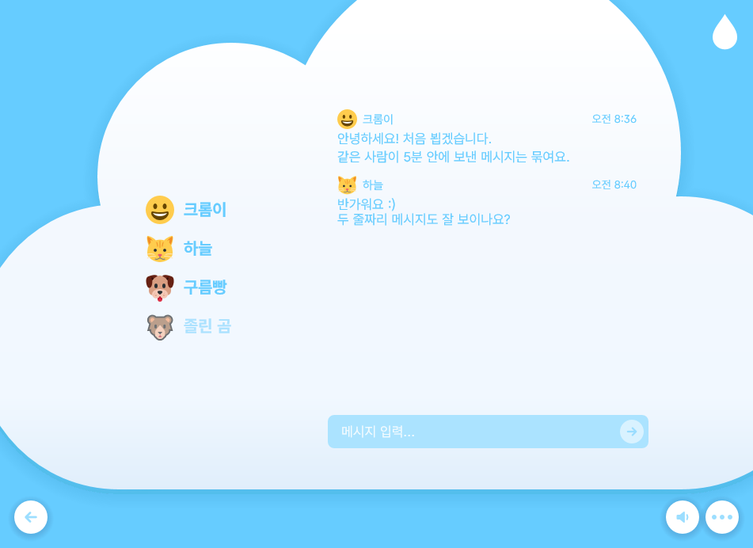

# Cloudroom++

[English](README.md) | **한국어**

[](https://github.com/kawalain/crpp/actions/workflows/ci.yml)

Cloudroom용 작고 가벼운 Windows 네이티브 클라이언트입니다. Cloudroom은 여러 사람이 한 구름(Room)에
모여 서로의 키보드와 마우스 입력을 소리로 듣는 서비스입니다. 각자 다른 곳에 있어도 같은 사무실에서
일하는 듯한 느낌을 줍니다.

Cloudroom++는 [공식 클라이언트](https://github.com/pb29/Cloudroom)를 C++로 따로 다시 작성한 프로그램으로,
같은 기능과 화면을 목표로 하면서 CPU와 메모리를 최대한 적게 쓰려고 합니다.

| 홈 | 구름 |
| --- | --- |
|  |  |

앱 화면은 한국어입니다. 스크린샷의 이름과 메시지는 샘플 데이터입니다.

## 기능

- **구름:** 구름을 새로 띄우거나 코드로 참여합니다. 연결이 끊겨도 내 자리가 한동안 유지됩니다.
- **소리:** 녹음된 키보드와 마우스 사운드 팩을 공간 음향과 잔향으로 내 주위에 배치합니다. 사운드 팩은
  사람마다 따로 고릅니다.
- **채팅과 프로필:** 구름 채팅, 별명, 이모지, 공개된 구름 찾기를 지원합니다.
- **계정은 선택 사항:** 게스트로 참여하거나, 로그인해서 고유한 `@사용자명`을 받을 수 있습니다.
- **Windows 연동:** 트레이 아이콘, 채팅 알림, 작업 표시줄 깜빡임, Windows 시작 시 자동 실행을 지원합니다.
- **적은 자원 사용:** 브라우저 엔진 없이 네이티브 Win32와 Direct2D로 그립니다. 유휴 상태에서는 아무것도
  그리지 않고 폴링도 하지 않습니다.

## 개인정보

**구름에 있는 동안 다른 사람은 내가 언제 입력하는지 알 수 있지만, 무엇을 입력하는지는 알 수 없습니다.**

### 다른 사람이 알 수 있는 것

다른 사람은 내가 키나 마우스 휠, 버튼을 언제 사용했는지와 어떤 마우스 버튼을 눌렀는지 알 수 있습니다. 어떤
키를 눌렀는지, 마우스가 어디에 있는지는 알 수 없습니다.

입력 상세 모드를 켜면 Space와 Enter 같은 특수 키도 각자의 소리를 냅니다. 글자와 숫자는 이 모드에서도 구분되지
않습니다.

### 내 PC에 남는 것

입력은 구름에 있는 동안에만 읽으며, 기록으로 남기지 않습니다. 로그인 정보와 채팅 캐시는 암호화해 저장합니다.
공식 클라이언트의 파일을 함께 쓰는 동안에는 암호화되지 않지만, 앱에서 암호화된 저장소로 옮길 수 있습니다.

자세한 근거는 [ADR 0003](docs/adr/0003-presence-mode-by-default.md)과
[ADR 0001](docs/adr/0001-protected-store-with-shared-fallback.md)에 있습니다.

## 설치

### 요구 사항

- Windows 10 버전 1703 이상
- C++ 도구를 포함한 [Visual Studio Build Tools 2022](https://visualstudio.microsoft.com/downloads/).
  다른 라이브러리나 패키지 관리자는 필요 없습니다.
- `PATH`에 등록된 [CMake](https://cmake.org/) 3.28 이상
- 첫 구성 단계에서 폰트와 이모지를 내려받기 위한 인터넷 연결. 실패해도 빌드는 되며, 시스템 폰트와 이모지를
  사용합니다.

### 빌드

저장소 최상위 폴더의 PowerShell이나 명령 프롬프트에서 실행합니다. 스크립트가 컴파일러 환경을 설정하므로
개발자 프롬프트는 필요 없습니다.

```bat
.github\scripts\msvc-build.cmd build-msvc
```

## 사용법

앱을 실행합니다.

```bat
build-msvc\apps\gui\crpp.exe
```

처음 실행하면 별명을 정하거나 로그인하라는 안내가 나옵니다. 그다음 홈 화면에서 아래 순서로 사용합니다.

1. **구름 띄우기**로 구름을 만들거나, **구름 찾기**에 코드를 입력해 참여합니다.
2. 구름 코드를 다른 사람에게 알려 줍니다.
3. 평소처럼 입력합니다. 오른쪽 위의 물방울을 누르면 음량과 사운드 팩 등을 바꾸는 설정이 열립니다.

기본 설정에서는 창을 닫으면 트레이로 숨겨집니다. 구름에 있었다면 **연결이 유지되고** 입력 타이밍도 계속
공유되므로, 원하지 않으면 먼저 구름에서 나가세요.

앱 데이터는 `%LOCALAPPDATA%\crpp\`에 저장됩니다. 이 폴더를 건드리지 않고 시험해 보려면 다른 폴더를
지정하세요. 이 옵션은 반드시 맨 뒤에 적어야 합니다.

```bat
build-msvc\apps\gui\crpp.exe --data D:\crpp-test
```

### 부가 도구

빌드하면 작은 명령줄 프로그램 두 개도 함께 만들어집니다.

`crpp_soundtest`는 모든 자리를 돌며 소리를 재생해, 공간 음향을 귀로 판단할 수 있게 합니다.

```bat
build-msvc\apps\soundtest\crpp_soundtest.exe assets\sounds
```

`crpp_cli`는 구름에 참여하거나 구름을 만들고, 채팅 메시지 하나를 보낸 뒤 그 메시지가 돌아오기를 기다립니다.
돌아왔을 때만 종료 코드 0으로 끝납니다.

```bat
build-msvc\apps\cli\crpp_cli.exe <server-url> <nickname> create <message>
build-msvc\apps\cli\crpp_cli.exe <server-url> <nickname> join <code> <message>
```

## 지원

Cloudroom++는 별개의 프로그램이므로, 관련 문제를 공식 클라이언트 개발자에게 문의하지 말아 주세요.

## 만든이

Cloudroom++는 [@kawalain](https://github.com/kawalain)이 관리합니다.

- Cloudroom 서비스, 시각 디자인, 사운드 팩은 [`pb29/Cloudroom`](https://github.com/pb29/Cloudroom) 소유자에게서 왔으며, 소유자는 사운드를
  여기에서 사용하고 공개하는 데 동의했습니다.
- 앱 폰트는 [Pretendard GOV](https://github.com/orioncactus/pretendard)입니다.
- 이모지 대부분은 [Twemoji](https://github.com/jdecked/twemoji)입니다.

## 라이선스

소스 코드는 [MIT 라이선스](LICENSE)로 제공됩니다.

MIT 라이선스는 `assets/`, `apps/gui/icon/`의 앱 아이콘, 같은 아트워크가 보이는 `docs/images/`의 스크린샷에는
적용되지 않습니다. 여기에는 각자의 조건을 따르는 다른 출처의 저작물이 포함되어 있습니다.

- `assets/sounds/`: 모든 권리는 소유자에게 있으며, 오픈 라이선스가 적용되지 않습니다.
- `assets/emoji/`(직접 그린 이모지)와 `assets/words/`는 공식 클라이언트에서 가져왔으며, 메인테이너의 허가를 받아
  사용합니다.
- 앱 아이콘은 공식 클라이언트의 디자인을 따르며, 여기에서 재사용하도록 허가되어 있지 않습니다.
- Pretendard GOV: [SIL Open Font License](https://github.com/orioncactus/pretendard/blob/v1.3.9/LICENSE)
- Twemoji: © Twitter, Inc. and contributors,
  [CC BY 4.0](https://creativecommons.org/licenses/by/4.0/)

자세한 내용은 [assets/README.md](assets/README.md)에 있습니다.
