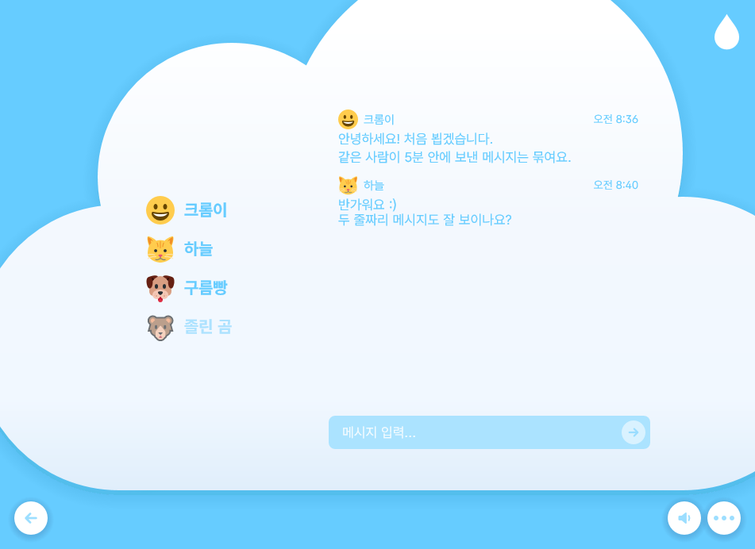

# Cloudroom++

**English** | [한국어](README.ko.md)

[](https://github.com/kawalain/crpp/actions/workflows/ci.yml)

A small, native Windows client for Cloudroom, a service where a group of people share a
Room and hear each other's keyboard and mouse as sound. It feels a little like working
in the same office, even when everyone is somewhere else.

Cloudroom++ is a separate C++ rewrite of the [official client](https://github.com/pb29/Cloudroom)
that aims for the same features and screens, using as little CPU and memory as it can.

| Home | Room |
| --- | --- |
|  |  |

The interface is in Korean and English. In these screenshots, the names and messages are sample data.

## Features

- **Rooms:** create one or join with a code. Your Seat is kept for a while if you disconnect.
- **Sound:** recorded keyboard and mouse sound packs, placed around you with spatial audio
  and reverb. Each member picks their own packs.
- **Chat and profiles:** Room chat, nicknames, emoji and public Room search.
- **Accounts are optional:** join as a Guest, or sign in to get a unique `@handle`.
- **Skins:** Cloud, the look of the official client, and Retro, in the look of the desktops of the
  1990s and early 2000s, with its own window and notification sounds. Pick a Skin, a Theme and a dark mode.
- **Windows integration:** tray icon, chat notifications, taskbar flash and start with Windows.
- **Light on resources:** native Win32 and Direct2D with no browser engine. While idle, the
  app draws nothing and doesn't poll.

## Privacy

**While you are in a Room, others can tell when you type, but not what you type.**

### What others can see

Others learn when you press a key or use the mouse wheel or a button, and which mouse button
it was. They don't learn which key you pressed or where your mouse is.

If you turn on Detail mode, special keys such as Space and Enter play their own sounds, and letter
and digit keys sound by the row of the keyboard they are on, so others learn that row too.

### What stays on your PC

Input is only read while you are in a Room, and it is never logged. Login details and the chat
cache are stored encrypted. While Cloudroom++ shares the official client's files they are not,
and you can move them to encrypted storage from the app.

The reasoning is in [ADR 0003](docs/adr/0003-presence-mode-by-default.md) and
[ADR 0001](docs/adr/0001-protected-store-with-shared-fallback.md).

## Installation

### Requirements

- Windows 10 version 1703 or later
- [Visual Studio Build Tools 2022](https://visualstudio.microsoft.com/downloads/) with the
  C++ tools. No other libraries or package managers are needed.
- [CMake](https://cmake.org/) 3.28 or later on `PATH`
- [Git for Windows](https://gitforwindows.org/), whose Git Bash runs the build script
- Internet access during the first configure, which downloads the font and emoji. If that
  fails the build still works and uses the system's font and emoji.

### Build

Run this in Git Bash at the repository root. The script sets up the compiler, so you don't
need a developer prompt:

```bash
.github/scripts/msvc-build.sh build-msvc
```

## Usage

Start the app:

```bat
build-msvc\apps\gui\crpp.exe
```

On the first run it asks you to choose a nickname or sign in. Then, on the Home screen:

1. Choose **구름 띄우기** to create a Room, or type a code under **구름 찾기** to join one.
2. Share the Room's code with others.
3. Type as usual. The droplet at the top right opens settings, including volume and sound packs.
   Under the Retro Skin it is **Tools > Options** in the menu bar.

By default, closing the window hides it to the tray. If you are in a Room, **you stay
connected** and your input timing keeps being shared, so leave the Room first if you don't
want that.

The app keeps its data in `%LOCALAPPDATA%\crpp\`. To try it without touching that folder,
give it another one, which must be the last argument:

```bat
build-msvc\apps\gui\crpp.exe --data D:\crpp-test
```

### Extra tools

The build also makes two small command-line programs.

`crpp_soundtest` walks a sound through every seat, so you can judge spatial audio by ear:

```bat
build-msvc\apps\soundtest\crpp_soundtest.exe assets\sounds
```

`--chimes` plays the notification sounds of the Retro Skin instead.

`crpp_cli` joins or creates a Room, sends one chat message and waits for it to come back. It
exits with 0 only if it does:

```bat
build-msvc\apps\cli\crpp_cli.exe <server-url> <nickname> create <message>
build-msvc\apps\cli\crpp_cli.exe <server-url> <nickname> join <code> <message>
```

## Support

Cloudroom++ is a separate program, so please don't take problems with it to the official
client's developers.

## Authors

Cloudroom++ is maintained by [@kawalain](https://github.com/kawalain).

- The Cloudroom service, its visual design and the sound packs come from the owner of
  [`pb29/Cloudroom`](https://github.com/pb29/Cloudroom), who agreed to the sounds being used and published here.
- [Pretendard GOV](https://github.com/orioncactus/pretendard) is the app's font.
- [Twemoji](https://github.com/jdecked/twemoji) provides most of the emoji.

## License

The source code is available under the [MIT License](LICENSE).

The MIT License does not cover `assets/`, the app icon in `apps/gui/icon/`, or the
screenshots in `docs/images/`, which show the same artwork. These include work from other
sources with their own terms:

- `assets/sounds/`: all rights stay with their owner, and no open license applies.
- `assets/emoji/` (hand-made emoji) and `assets/words/` come from the official client and
  are used here with its maintainer's permission.
- The app icon follows the official client's design and is not licensed for reuse here.
- Pretendard GOV: [SIL Open Font License](https://github.com/orioncactus/pretendard/blob/v1.3.9/LICENSE)
- Twemoji: © Twitter, Inc. and contributors,
  [CC BY 4.0](https://creativecommons.org/licenses/by/4.0/)

See [assets/README.md](assets/README.md) for details.
